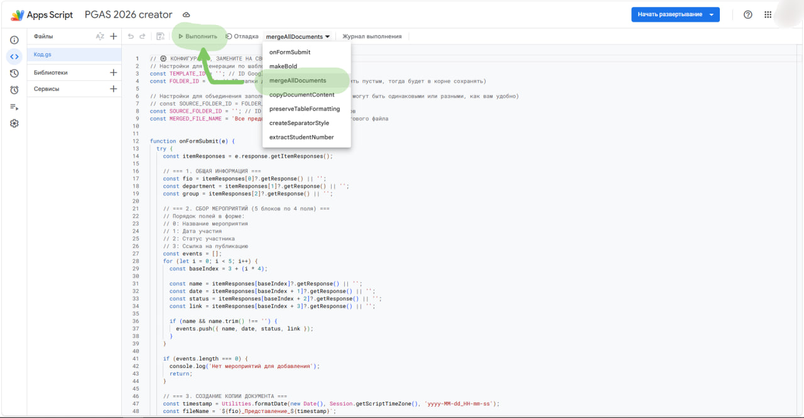

# NSU_PGAS_generator  
Код и инструкция поставляется как есть — ответственности за использование не несу и обновлений не обещаю!  
Гайд для копирования себе генератора "Представления ПГАС" на основе Google Forms с использованием Google App Script.  
  
  
# Гайд. Копирование генератора себе  
  
## Глоссарий  
* **Файл одиночка** — файл, в котором заполнено представление на ПГАС только по одному человеку (один раз заполнил форму — создался один "файл одиночка")  
* **Сборник ПГАС** — файл, в котором заполненные представления на ПГАС для нескольких людей (Иванов, Петров, Сидоров — все люди, отдельно по листам, с заполненными таблицами мероприятий)  
* **ID папки** или **ID файла** — часть ссылки.  
* * Например, для папки `https://drive.google.com/drive/u/0/folders/1jg96tXhA_LOL__KEK_zAy_CHEBUREK_9` ID будет `1jg96tXhA_LOL__KEK_zAy_CHEBUREK_9` — последняя часть ссылки.  
* * Для файла ссылка `https://docs.google.com/document/d/1g5TxNIVT8lYOY389vlz_FE4O40k1sSpLJSdIolVziZ8/edit?tab=t.0`, а ID будет `1g5TxNIVT8lYOY389vlz_FE4O40k1sSpLJSdIolVziZ8` — предпоследняя часть ссылки перед `/edit&tab=t.0`  
  
## Шаги копирования  
### Шаг 1. Скопировать форму  
*ссылка на копирование моей формы:* `https://docs.google.com/forms/d/1MWAc4DHeRXkkrtJLzHjIwhl5X4T6XzxywSVVftoebdw/copy`  
1) Заранее зайдите в нужный вам Google-аккаунт (рекомендую аккаунт НГУ)  
2) Перейдите по ссылке — нажмите [Создать копию] (будет предложено скопировать и Google-форму, и код автоматизации App Script к ней)  
     
3) [Фото] Обязательно опубликуйте форму. ***Настройка прав доступа на вашей ответственности!***  
     
     
5) Немного отредактируйте скрипт — Шаг 2  
  
### Шаг 2. Скрипт под себя  
В идеале, код уже скопирован от моего исходника, вам лишь необходимо указать где на вашем Google-диске лежит шаблон, в какую папку сохранять заполненные шаблоны по одному человеку и в какую папку сохранять единой файл (склейка одиночных файлов в один, для отправки Д.А. в УМПВР)  
1) Откройте Google-форму из Шага 1 (в идеале оно само уже открыто после Шага 1. И ссылка уже новая — ваша)  
2) Справа сверху нажмите на три точки → App Script  
     
3) Вы открыли Google App Script, уже привязанный к вашей Google-форме  
     
*) если кода нет, *всякое бывает*, скопируйте его ЦЕЛИКОМ из файла `Google App Script.js`  
4) Откуда брать всякие ID для заполнения — смотрите Шаг 3  
  
### Шаг 3. ID папок и файлов  
*где брать ID кратко описано в Глоссарии в начале этого гайда*  
  
#### 3.1. Шаблон ПГАС  
*Просто: скопируйте мой шаблон и сразу к Шагу 3.1.6.*  
Файл → Создать копию  
*ссылка на мой шаблон:* `https://docs.google.com/document/d/1g5TxNIVT8lYOY389vlz_FE4O40k1sSpLJSdIolVziZ8/edit?tab=t.0`  
  
  
1) Загрузите docx шаблон от УПМВР на ваш Google Drive (в любую удобную папку ВАШЕГО Google диска)  
2) Откройте этот документ (двойной щелчок или что-то вроде)  
3) Замените часть полей точь-в-точь как в моём шаблоне — именно по ним происходит подстановка: `{{Doc_date}}`, `{{Group}}`, `{{Department}}`, `{{FIO}}` и таблицу приведите в нужный вид `№ | Наименование мероприятия | Дата проведения | Ссылка на мероприятие | Статус участника` и под такой "шапкой таблицы" 5 пустых строк, иначе генерация станет кривой или вовсе сломается.  
4) В меню "Файл" выберите "Открыть как документ Google" — ждите конвертации "docx → Google Doc"  
5) Теперь в той же папке есть "Шаблон ПГАС.docx" и просто "Шаблон ПГАС" (у них даже иконка различается) — это MS docx и Google Doc соответственно  
6) Откройте Google Doc "Шаблон ПГАС" (или вернитесь на вкладку в пункте 3) и посмотрите на ссылку — вам важна только её часть, то самое ID  
  
#### 3.2. Папки  
1) Создайте папку где вам удобно  
     
2) Зайдите в неё  
3) Посмотрите на ссылку — часть ссылки и есть ID папки  
     
*вам таких папки желательно создать две: 1 — для файлов одиночек, 2 — для файлов сборников ПГАС*  
  
### Шаг 4. Права доступа  
*в любом порядке, главное все права выдать. Возможно достаточно пункта 4.2., проверьте и убедитесь на всякий случай*  
#### 4.1. Права на Google Drive:  
Находясь в App Script просто запустите функцию `onFormSubmit` один раз, выскочит окошко с "дайте права этому приложению использовать ваш Google Drive" — согласитесь  
*чтобы читать Шаблон ПГАС и сохранять файлы одиночки, удивительно, правда?*  
  
  
  
  
  
  
#### 4.2. Права на Google-форму [точнее **добавление триггера "форма отправлена — запустить код"**]:  
Всё также внутри App Script нажмите на **часики-будильник в левом меню**, добавьте триггер:  
* Функция: **onFormSubmit**  
* Выполняемое развёртывание: **Основное развёртывание**  
* Выберите источник события: **Из формы**  
* Выберите тип события: **При отправке формы**  
* Настройки уведомлений од ошибках: **Немедленно**  
  
  
  
  
  
### Done!  
Теперь волонтёры или вы можете заполнять форму — документы будут создаваться по шаблону в выбранную вами папку.  
  
### Бонус. Как объединять все файлы в один  
1) Откройте вашу форму  
2) Перейдите в (Google) App Script  
3) Среди функций выберите `mergeAllDocuments`  
4) Чуть левее нажмите `Выполнить`  
5) Подождите и проверьте папку со сборниками ПГАС  
  
  
*Да, придётся открывать Google-форму, затем App Script. Ничего удобнее я придумывать не планирую:*  
*кнопка "объединить всё" используется всего 1-2 раза в семестр, в январе/июне*  
  
  
## Пример заполнения формы:  
### Волонтёр 1  
#### Заполнение в форме  
  
  
  
#### Результат автоматизации  
  
  
### Волонтёр 2  
#### Заполнение в форме  
  
  
#### Результат автоматизации  
  
  
### Папка одиночек до/после  
  
  
  
  
## Бонус. Пример сбора файлов одиночек  
  
  
  
